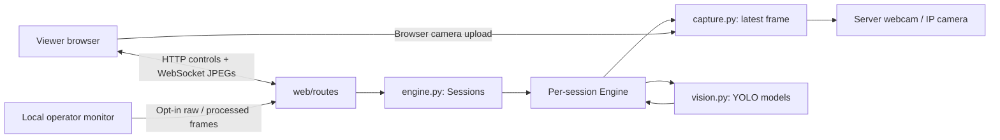

# Architecture

The Python backend runs on the host laptop. FastAPI serves the static frontend
and control APIs; Uvicorn hosts HTTP and WebSocket connections. Cloudflare Tunnel
forwards a public HTTPS hostname to loopback. Model execution stays on the host.

## Module boundaries

- `config.py` validates source, features, quality, and inference parameters. It
  translates legacy mode values into the current feature checklist.
- `capture.py` owns camera/network readers and browser-upload capture. Input
  frames are replaced rather than queued indefinitely.
- `vision.py` resolves devices, selects weights, performs inference and draws
  overlays. Segmentation can supply object boxes without an extra detector.
- `engine.py` owns model/capture lifecycle, output buffers, and session cleanup.
  Its worker threads run independently but share the host's compute resources.
- `web/app.py` assembles the application. `web/routes/controls.py` owns settings
  and status, `streaming.py` owns HTTP/WebSocket video transport, `operator.py`
  owns local-only viewing, and `pages.py` serves the dashboard.
- `web/middleware.py` owns cookies and same-origin controls; `web/lifecycle.py`
  creates and cleans up the session registry.
- `web/templates/` and `web/static/` contain packaged HTML, JavaScript, and CSS.
  Public URLs such as `/static/app.js` remain stable.
- `cli/server.py` and `cli/desktop.py` implement the two command-line interfaces.
  Root package `app.py`, `server.py`, and `desktop.py` remain compatibility entry
  points for existing commands and integrations.
- `paths.py` locates packaged assets and writable runtime directories independently
  of the shell's working directory.

## Sessions and data lifecycle

An HttpOnly cookie identifies a browser profile's session. Tabs in one profile
share it; different profiles/devices have independent settings and frame buffers.
There is a maximum of 32 registered sessions and an approximately 90-second idle
cleanup period. This is not a guarantee of 32 simultaneous heavy inference users.
Workers share CPU/GPU, VRAM, and bandwidth. Weight loading is serialized to avoid
conflicting first-use downloads; inference is not globally batched or fairly
scheduled.

Browser camera uploads use generation-prefixed JPEG messages. The generation
prevents old frames from being applied after a configuration change. Input,
encoded output, and pending browser rendering buffers retain their latest frames.
HTTP upload/preview endpoints remain available as a WebSocket fallback.

Operator viewing requires both a localhost hostname and loopback client address,
plus the client's opt-in setting. Raw viewing reuses received JPEGs; annotated
viewing reuses processed output. Revocation/Stop blocks access immediately. Frames
are held in memory and are not recorded.

## Packaging and scripts

Install editable with `uv pip install --python .venv-system/Scripts/python.exe -e .`.
The `src` layout prevents loose root files from accidentally shadowing imports.
The frontend is shipped as package data in both editable installs and wheels;
there is no separate frontend deployment or build step. Wheel installations
store generated files under `~/.yolo-studio/runtime/`, while editable checkout
runs use the repository's `runtime/`. `YOLO_STUDIO_RUNTIME_DIR` overrides either
location. Keep this writable directory outside the installed package.

When adding endpoints, choose the appropriate router; application assembly should
only register middleware, assets, and routers. Capture and model processing belong
in the shared modules so both web and desktop interfaces can reuse them.

Root PowerShell scripts are the single implementations for setup, launch, and
stop commands. `scripts/lib/python.ps1` shares Python discovery, working-directory
and import-path handling. There are no CMD wrappers or duplicate launch scripts.
The PyTorch installer selects official CPU/CUDA
wheels before installing the package. It uses the primary download host when an
alternate official hostname cannot resolve.

Generated files live under ignored `runtime/`:

- `models/`: downloaded YOLO weights.
- `logs/`: background process logs.
- `pids/`: recorded background process IDs.
- `artifacts/`: synthetic-data browser screenshots.

The restructuring retained the original Python files as ignored
`runtime/*.pre-refactor` copies for local recovery. They are not used by the app
or included in Git.

Before changing capture/inference behavior, run the smoke check and the
integration scripts listed in the root README. Use a separate server port for
tests. Never commit environments, logs, model binaries, camera frames, or local
credentials.

## Server audio

`audio.py` owns one shared PortAudio input via sounddevice, opened on the first
explicit listener subscription and released on the last unsubscribe. A bounded
queue per listener drops older audio under load. `web/routes/audio.py` checks
same-origin and an existing session, binds listening to its current generation,
and allows it only while that session's server camera is running. Its sender and
receiver run together so disconnects and source/Stop changes release the input.
`web/static/audio.js` schedules PCM buffers through Web Audio after a user gesture;
`viewer.js` provides shared native/fallback fullscreen behavior for both pages.
Audio is independent of model processing and is not synchronized with CV frames.
