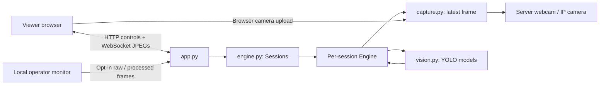

# Architecture

The Python backend runs on the host laptop. FastAPI serves the static frontend
and control APIs; Uvicorn hosts HTTP and WebSocket connections. Cloudflare Tunnel
forwards a public HTTPS hostname to loopback. Model execution stays on the host.

## Module boundaries

- `config.py` validates source, features, quality, and inference parameters. It
  translates legacy mode values into the current feature checklist.
- `capture.py` owns camera/network readers and browser-upload capture. Input
  frames are replaced rather than queued indefinitely.
- `vision.py` resolves devices, selects weights, performs inference and draws
  overlays. Segmentation can supply object boxes without an extra detector.
- `engine.py` owns model/capture lifecycle, output buffers, and session cleanup.
  Its worker threads run independently but share the host's compute resources.
- `app.py` handles HTTP/WebSocket transport, cookies, origin checks, and local
  operator restrictions. It delegates processing to session engines.
- `server.py` and `desktop.py` provide separate web and OpenCV entry points.
- `paths.py` centralizes repository paths so cached weights and static assets
  do not depend on the shell's working directory.

## Sessions and data lifecycle

An HttpOnly cookie identifies a browser profile's session. Tabs in one profile
share it; different profiles/devices have independent settings and frame buffers.
There is a maximum of 32 registered sessions and an approximately 90-second idle
cleanup period. This is not a guarantee of 32 simultaneous heavy inference users.
Workers share CPU/GPU, VRAM, and bandwidth. Weight loading is serialized to avoid
conflicting first-use downloads; inference is not globally batched or fairly
scheduled.

Browser camera uploads use generation-prefixed JPEG messages. The generation
prevents old frames from being applied after a configuration change. Input,
encoded output, and pending browser rendering buffers retain their latest frames.
HTTP upload/preview endpoints remain available as a WebSocket fallback.

Operator viewing requires both a localhost hostname and loopback client address,
plus the client's opt-in setting. Raw viewing reuses received JPEGs; annotated
viewing reuses processed output. Revocation/Stop blocks access immediately. Frames
are held in memory and are not recorded.

## Packaging and scripts

Install editable with `uv pip install --python .venv-system/Scripts/python.exe -e .`.
The `src` layout prevents loose root files from accidentally shadowing imports.
This application is run from its checkout: the frontend is a sibling directory,
not a separately hosted asset bundle or standalone wheel resource.

Root CMD launchers are compatibility wrappers; their implementations and setup
logic live under `scripts/`. The PyTorch installer selects official CPU/CUDA
wheels before installing the package. It uses the primary download host when an
alternate official hostname cannot resolve.

Generated files live under ignored `runtime/`:

- `models/`: downloaded YOLO weights.
- `logs/`: background process logs.
- `pids/`: recorded background process IDs.
- `artifacts/`: synthetic-data browser screenshots.

The restructuring retained the original Python files as ignored
`runtime/*.pre-refactor` copies for local recovery. They are not used by the app
or included in Git.

Before changing capture/inference behavior, run the smoke check and the
integration scripts listed in the root README. Use a separate server port for
tests. Never commit environments, logs, model binaries, camera frames, or local
credentials.
